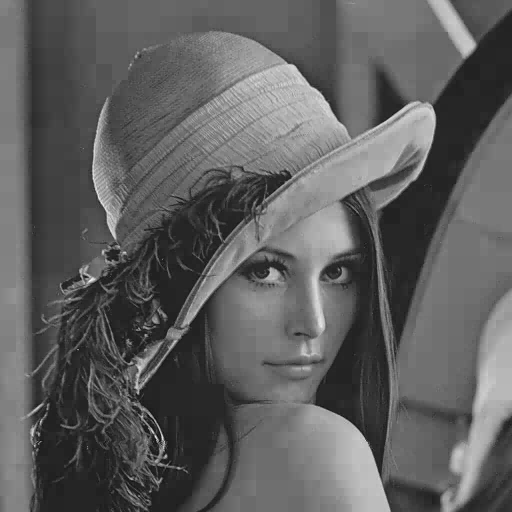

# Encoding and decoding

[Back to the README](../README.md)

There are two binaries. `pie-encode` compresses an image into a `.pie` file:

    cargo run --release --bin pie-encode -- lena.png lena.pie

    processing  lena.png (  786432 bytes)
    wrote       lena.pie (   57369 bytes, colour (7.3%, 1.75 bpp))

`pie-decode` turns it back into an image (here a PNG):

    cargo run --release --bin pie-decode -- lena.pie decoded_lena.png

    decoding    lena.pie
    wrote       decoded_lena.png (512x512 colour)

The decoded image is bit-for-bit identical to the reference render above.

Input and output paths can be overridden, and both error bounds are optional
flags on the encoder:

    pie-encode [input] [output.pie] [--max-error N] [--chroma-max-error N]
    pie-decode [input.pie] [output]

`--max-error` is the luma (and greyscale) bound; `--chroma-max-error` is the
chroma bound. A larger bound tolerates a coarser fit, so fewer regions are
subdivided and the file gets smaller. For the 512x512 Lena image:

| luma | chroma | `.pie` | bpp  |
| ---- | ------ | ------ | ---- |
| 32   | 16     | 67326  | 2.05 |
| 32   | 32     | 61062  | 1.86 |
| 32   | 64     | 57369  | 1.75 |
| 32   | 128    | 55824  | 1.70 |
| 32   | 256    | 55463  | 1.69 |
| 64   | 64     | 38501  | 1.17 |
| 16   | 64     | 85925  | 2.62 |

The luma plane dominates: once the chroma bound reaches about 128 the chroma
planes cost next to nothing.

## Image formats

The format is chosen from the file extension, in both directions:

| extension         | format    | read | write |
| ----------------- | --------- | ---- | ----- |
| `.png`            | PNG       | yes  | yes   |
| `.jpg` / `.jpeg`  | JPEG      | yes  | yes   |
| `.tif` / `.tiff`  | TIFF      | yes  | yes   |
| `.bmp`            | BMP       | yes  | yes   |
| `.gif`            | GIF       | yes  | yes   |
| `.webp`           | WebP      | yes  | yes   |
| `.jp2`            | JPEG 2000 | yes  | yes   |
| `.j2k` / `.j2c`   | JPEG 2000 | yes  | yes   |
| `.heic` / `.heif` | HEIC      | yes  | no    |

So `pie-decode lena.pie lena.jpg` writes a JPEG and `pie-encode photo.tiff
photo.pie` reads a TIFF. An unrecognised extension is an error rather than a
guess. Any listed input can be decoded to any listed output, except that HEIC
is read-only.

Most formats go through [the `image` crate](https://docs.rs/image), which
normalises bit depth and palettes. JPEG 2000 uses
[`oxideav-jpeg2000`](https://docs.rs/oxideav-jpeg2000): a `.jp2` output is a
JP2 container and a `.j2k` / `.j2c` output a bare codestream, both with the
reversible 5-3 kernel, so they round-trip losslessly. HEIC reads through
[`heic-rs`](https://docs.rs/heic-rs); that crate is a decoder, so writing a
`.heic` is refused with an explanation. All three are pure Rust under
permissive licences — nothing here links a C library or takes on AGPL/GPL
terms.

JPEG is lossy and GIF is palettised, so those outputs only approximate the
`.pie` payload; PNG, TIFF, BMP, WebP and JPEG 2000 round-trip losslessly.

## Aspect ratio

A near-square region is still cut into four quadrants; a region whose sides
differ by more than 2:1 is instead cut in two along its longer side. Both
choices follow from the region's dimensions alone, so the decoder reproduces
them for free and no image has to be padded to a square. The extra two-way
nodes cost very little, even at extreme ratios:

| image   | `.pie` | bpp  |
| ------- | ------ | ---- |
| 512x512 | 57369  | 1.75 |
| 512x200 | 27457  | 2.15 |
| 200x512 | 27198  | 2.12 |
| 1024x64 | 13983  | 1.71 |

The non-square figures are crops/rescales of Lena, all at the default bounds.

Any image dimensions are supported. Already-greyscale inputs skip the YCbCr
step and are encoded directly:

    processing  grey.png (  262144 bytes)
    wrote       grey.pie (   55487 bytes, greyscale (21.2%, 1.69 bpp))

## Tests

    cargo test --release

That is all.
